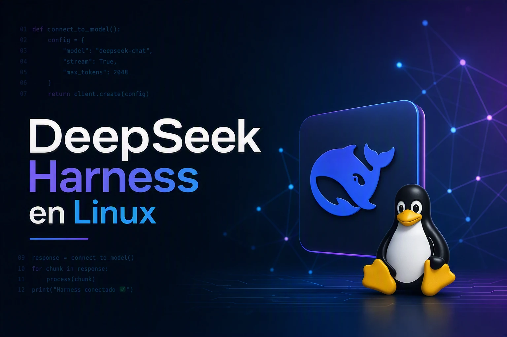

# Manual: Instalar DeepSeek Harness en Linux (Debian/Ubuntu) y configurar modelos gratis y de pago



> **Nota importante sobre el comando `dsh`**
>
> Si escribes `dsh --version` y aparece *"Distributed Shell / Dancer's shell"*, **no es DeepSeek Harness**. Existe un programa antiguo de Linux con ese nombre. En Debian/Ubuntu, `sudo apt install dsh` instala ese otro programa, no el nuestro.
>
> DeepSeek Harness (dsh) **no se instala con `apt`**. Se instala clonando su repositorio y ejecutándolo con `pnpm`. La forma correcta de comprobar la versión es:
>
> ```bash
> pnpm run dsh --version
> ```
>
> que mostrará algo como `0.2.2-rc.3`.

---

## Qué es DeepSeek Harness y para qué sirve

**DeepSeek Harness** es una aplicación de IA que actúa como **agente de programación**. Se ejecuta en tu ordenador y abre una página web en el navegador. En esa página escribes lo que quieres hacer y la IA lo hace por ti, pidiéndote permiso antes de tocar archivos o ejecutar comandos.

Puedes conectar **varios proveedores de IA al mismo tiempo** y cambiar de uno a otro desde la interfaz sin reiniciar nada:

```
DeepSeek Harness (dsh)
├── DeepSeek (nativo, API de pago)
│   └── deepseek-v4-flash / deepseek-v4-pro
├── TokenRouter (gratis)
│   └── z-ai/glm-5.3-free
└── NVIDIA (gratis)
    └── nvidia/nemotron-3-super-120b-a12b
```

---

## Palabras complicadas explicadas

- **Repositorio:** carpeta de proyecto guardada en GitHub que puedes copiar a tu ordenador.
- **Clonar:** copiar un repositorio con `git clone`.
- **Terminal:** la ventana donde escribes comandos.
- **Dependencias:** programas auxiliares que el proyecto necesita. Se descargan con `pnpm install`.
- **Compilar / build:** traducir el código fuente a algo que el ordenador ejecute. Se hace con `pnpm run build`.
- **API:** puerta por la que un programa se comunica con otro. **API key** es la llave, un código secreto.
- **Proveedor:** servicio que te da acceso a modelos de IA (DeepSeek, NVIDIA, TokenRouter).
- **Modelo:** el "cerebro" de IA concreto que usas.
- **Workspace:** la carpeta de tu ordenador sobre la que el agente puede trabajar.
- **Token (en la URL):** contraseña temporal que se añade a la dirección web.
- **Puerto:** número que identifica un programa de tu ordenador. dsh usa el `3080`.
- **`~` (virgulilla):** "mi carpeta personal" (ej. `/home/wachin`). `~/.dsh` es `/home/wachin/.dsh`.
- **`.bashrc`:** archivo oculto que se lee cada vez que abres la terminal. Sirve para configurar cosas permanentes.
- **Variable de entorno:** valor que el sistema guarda y que los programas leen (ej. `DEEPSEEK_API_KEY`).
- **YAML:** formato de archivo de configuración, fácil de leer.

---

## 1. Requisitos

### Node.js 24.9 o superior (obligatorio)

> **Aviso:** desde finales de 2026, DeepSeek Harness exige **Node.js 24.9.0 o superior**. Con Node 22 falla la compilación con un error `SIGKILL`. Si ya tenías Node 22, hay que actualizar.

Instala Node desde NodeSource:

```bash
sudo apt update
sudo apt-get install -y curl
curl -fsSL https://deb.nodesource.com/setup_24.x | sudo -E bash -
sudo apt-get install -y nodejs
```

Comprueba la versión (**debe ser 24.9 o superior**):

```bash
node --version
```

### npm (viene con Node)

`npm` se instala automáticamente junto con Node.js. No hace falta instalarlo aparte. Compruébalo con:

```bash
npm --version
```

> **Nota sobre permisos de npm:** si al instalar paquetes globales (`npm install -g ...`) aparece un error `EACCES: permission directed`, no modifiques los permisos de `/usr/lib`. En su lugar, configura las instalaciones globales en tu HOME:
>
> ```bash
> mkdir -p ~/.local/npm
> npm config set prefix ~/.local/npm
> echo 'export PATH="$HOME/.local/npm/bin:$PATH"' >> ~/.bashrc
> source ~/.bashrc
> ```

### pnpm

Es un gestor de dependencias. Si no lo tienes, instálalo mediante npm:

```bash
sudo npm install -g pnpm
```

### git

```bash
sudo apt install -y git
```

> **Ojo:** el paquete `dsh` que hay en `apt` **no es DeepSeek Harness**. Es un programa antiguo de Linux llamado *Distributed Shell*. Si lo instalas por error, no pasa nada, pero no sirve para lo que queremos. Para desinstalarlo si lo instalaste sin querer:
>
> ```bash
> sudo apt remove dsh libdshconfig1
> ```

---

## 2. Clonar e instalar (una sola vez)

```bash
git clone https://github.com/deepseek-ai/deepseek-harness.git
cd deepseek-harness
pnpm install
pnpm run build
```

`pnpm install` descarga dependencias y `pnpm run build` compila. El primer build tarda entre 5 y 20 minutos según el ordenador.

### ⚠️ Si tu ordenador tiene solo 8 GB de RAM

El build por defecto lanza **4 workers en paralelo** y puede llegar a consumir ~7,5 GB de RAM. Con 8 GB totales, el sistema operativo mata el proceso de compilación con un error `SIGKILL` en el paso `host aggregate check`.

La solución es **compilar en serie** con `DSH_GATE_CONCURRENCY=1`, que reduce el consumo a ~6,3 GB:

```bash
DSH_GATE_CONCURRENCY=1 pnpm run build
```

Si quieres que sea permanente (recomendado si tienes 8 GB o menos), añádelo a tu `~/.bashrc`:

```bash
echo 'export DSH_GATE_CONCURRENCY=1' >> ~/.bashrc
source ~/.bashrc
```

Con esa variable en `~/.bashrc`, ya puedes ejecutar `pnpm run build` normalmente y siempre compilará en serie.

> **Nota:** en un equipo de 8 GB, el build en serie tarda **más o menos lo mismo o incluso menos** que el paralelo. Cuando falta RAM, el paralelismo solo provoca que el kernel pase el tiempo reclamando páginas, así que no se gana nada.

### Si tienes 16 GB de RAM o más

Puedes dejar el build por defecto (paralelo). Será más rápido y no fallará.

---

## 3. Abrir DeepSeek Harness (cada vez)

```bash
cd ~/Dev3/deepseek-harness
pnpm dsh web
```

Al ejecutarlo, la terminal mostrará:

```
dsh web: http://127.0.0.1:3080/?token=lRn0K8364K86kkViiR4Sf_rP5OQp0NWNInNKxXx1Tnw
dsh web: opening the default browser; pass --no-open to disable
```

y el navegador se abrirá automáticamente en esa dirección.

### Detalles importantes

- La URL lleva un **token de acceso** (la cadena larga). Es una contraseña temporal.
- Si cierras la pestaña, copia la URL completa (con el token) desde la terminal para volver a entrar.
- El servidor corre en la terminal: para cerrarlo, pulsa `Ctrl + C`.
- **No hace falta volver a compilar después de reiniciar el ordenador.** Solo se compila al actualizar el repositorio.
- Si no quieres que se abra el navegador (por ejemplo, en SSH): `pnpm dsh web --no-open`

### Comprobar la versión de dsh

```bash
pnpm run dsh --version
```

Muestra algo como `0.2.2-rc.3`.

> **No uses `dsh --version` a secas.** Si tienes el `dsh` de apt instalado, ese comando muestra *"Distributed Shell"*, que no es nuestro programa. Para tener un atajo, añade al final de `~/.bashrc`:
>
> ```bash
> alias dsh="pnpm --dir ~/Dev3/deepseek-harness run dsh"
> ```
>
> Guardas, abres nueva terminal, y ya puedes escribir `dsh web` desde cualquier carpeta.

---

## 4. Primera vez: elegir el workspace

La primera vez que se abre la aplicación, hay que elegir el **workspace**: la carpeta del proyecto sobre la que el agente podrá trabajar.

1. Pulsa **Choose workspace**.
2. Navega hasta la carpeta de tu proyecto.
3. Confirma.

El agente solo podrá leer y modificar archivos dentro de esa carpeta. Es una medida de seguridad.

---

## 5. Configurar DeepSeek (proveedor nativo)

DeepSeek no requiere configuración especial: basta con que la variable `DEEPSEEK_API_KEY` exista en la terminal desde la que lanzas `dsh web`.

Añádela a `~/.bashrc`:

```bash
export DEEPSEEK_API_KEY="sk-XXXXXXXXXXXXXXXXXXXX"
```

Guardas, cierras terminal, abres otra.

> **No publiques esta clave.** No la subas a GitHub, no la pongas en capturas ni la envíes a nadie. Si alguien la obtiene, puede gastar tu dinero.

Al abrir la interfaz verás los modelos de DeepSeek en el selector:

- `deepseek-v4-flash`
- `deepseek-v4-pro`
- `deepseek-v4-flash-vision-exp` (experimental, con visión)

### Alternativa: guardar la clave desde la interfaz

También puedes hacerlo sin tocar `.bashrc`: **Settings → Models**, tarjeta **DeepSeek**, pega la clave y guarda. Queda almacenada en `~/.dsh/.credentials.yaml` (la interfaz solo muestra una versión censurada).

---

## 6. Configurar TokenRouter (gratis, compatible con OpenAI)

```
Base URL: https://api.tokenrouter.com/v1
Modelo:   z-ai/glm-5.3-free
```

En la interfaz:

1. **Settings → Models**.
2. **Add a custom provider**.
3. Rellena:

| Campo | Valor |
|---|---|
| Provider ID | `tokenrouter` |
| Display name | TokenRouter |
| Base URL | `https://api.tokenrouter.com/v1` |
| API protocol | OpenAI-compatible |
| API key | tu clave `sk-...` |
| Models | `z-ai/glm-5.3-free` |

4. Opcional: pulsa **Fetch available models** para que la interfaz consulte la lista de modelos disponibles.
5. Guarda.

---

## 7. Configurar NVIDIA (gratis, compatible con OpenAI)

```
Base URL: https://integrate.api.nvidia.com/v1
Modelo:   nvidia/nemotron-3-super-120b-a12b
```

1. **Settings → Models → Add a custom provider**.
2. Rellena:

| Campo | Valor |
|---|---|
| Provider ID | `nvidia` |
| Display name | NVIDIA |
| Base URL | `https://integrate.api.nvidia.com/v1` |
| API protocol | OpenAI-compatible |
| API key | tu clave `nvapi-...` |
| Models | `nvidia/nemotron-3-super-120b-a12b` |

3. **Fetch available models** funciona también aquí (devuelve una lista enorme: `deepseek`, `nemotron`, `qwen`, `glm`, etc.).
4. Guarda.

---

## 8. Elegir modelo y empezar a usar el agente

Todos los modelos configurados aparecen en el **selector de modelos** de la interfaz (abajo, cerca de donde escribes).

Selecciona uno y escribe tu primera tarea. Una prueba segura sin modificar nada:

```
Lista los archivos del directorio actual y dime sus nombres.
No modifiques, crees ni elimines ningún archivo.
```

Si el agente pide permiso para ejecutar herramientas, la interfaz muestra un cuadro de aprobación: permitir una vez, siempre en esta sesión, o denegar.

```
API (DeepSeek / TokenRouter / NVIDIA)
          ↓
   Modelo seleccionado
          ↓
   DeepSeek Harness (web)
          ↓
   Herramientas (shell, archivos, ...)
          ↓
        Linux
```

---

## 9. Cambiar de modelo o proveedor

No hay que reconfigurar nada:

1. Abre el selector de modelos.
2. Elige otro (aunque sea de otro proveedor).

Los cambios aplican en la siguiente petición, sin reiniciar el servidor.

Si borras un proveedor que era el modelo por defecto, la interfaz mostrará **Select model** y bloqueará la entrada hasta que elijas otro.

---

## 10. Dónde se guardan tus datos (y por qué hacer backup)

Todo está en `~/.dsh/` (carpeta oculta en tu HOME):

| Archivo / carpeta | Contenido |
|---|---|
| `settings.yaml` | Preferencias (idioma, onboarding, compatibilidad) |
| `.credentials.yaml` | Claves API guardadas desde la interfaz |
| `sessions/` | Historial completo de conversaciones y acciones |

- **`settings.yaml`**: panel de preferencias. Si lo borras, dsh vuelve al estado inicial (no pierdes conversaciones).
- **`.credentials.yaml`**: caja fuerte de claves en texto plano. **No lo compartas.**
- **`sessions/`**: la carpeta más valiosa. Contiene todo tu historial. Se conserva entre reinicios.

### Por qué hacer backup antes de actualizar

El proyecto está en **developer preview** y su README avisa con mayúsculas:

> *"THERE WILL BE COMPATIBILITY-BREAKING CHANGES."*

Las actualizaciones pueden cambiar el formato de las sesiones. Un archivo que la versión antigua escribía de una forma, la nueva puede esperar de otra. Si actualizas sin copia, puedes perder o corromper tus sesiones.

Haz la copia **antes** de actualizar:

```bash
cp -r ~/.dsh ~/.dsh-backup-$(date +%Y%m%d)
```

- `cp` = copiar
- `-r` = recursivo (copia también lo de dentro)
- `~/.dsh` = original
- `~/.dsh-backup-AAAAAMMDD` = copia con fecha (así conservas varias si actualizas varias veces)

Si algo sale mal:

```bash
rm -rf ~/.dsh
mv ~/.dsh-backup-YYYYMMDD ~/.dsh
```

---

## 11. Actualizar en el futuro (flujo correcto)

```bash
# 1. Backup ANTES de nada
cp -r ~/.dsh ~/.dsh-backup-$(date +%Y%m%d)

# 2. Actualizar el código
cd ~/Dev3/deepseek-harness
git pull
pnpm install --frozen-lockfile

# 3. Limpiar y compilar
pnpm run clean
pnpm run build        # usará DSH_GATE_CONCURRENCY=1 si lo pusiste en ~/.bashrc

# 4. Arrancar
pnpm dsh web
```

**¿Por qué es necesario `pnpm run clean`?**

Al compilar se generan archivos de caché (`.tsbuildinfo` y carpetas `lib/`) que dicen "esto ya está compilado". Al actualizar el código, esos archivos quedan **desincronizados** y el compilador falla con:

```
[MISSING_EXPORT] "..." is not exported by ...
```

`pnpm run clean` borra esos archivos viejos y obliga a recompilar todo desde cero. Si después del `clean` sigue fallando, haz limpieza total:

```bash
rm -rf node_modules pnpm-lock.yaml
pnpm install
pnpm run build
```

### Aviso "Update available" de pnpm

Al ejecutar `pnpm install`, pnpm puede mostrar:

```
Update available! 11.28.5 → 12.21.0.
```

**No es necesario actualizar pnpm.** El proyecto fija su versión en `package.json` (`"packageManager": "pnpm@..."`) y pnpm usa automáticamente esa dentro del repositorio. El aviso se puede ignorar.

---

## 12. Solución de problemas

### `SIGKILL` durante el build (equipos de 8 GB)

El paso `host aggregate check` falla con `signal SIGKILL`. Es falta de RAM. Solución:

```bash
pnpm run clean
DSH_GATE_CONCURRENCY=1 pnpm run build
```

Y añade `export DSH_GATE_CONCURRENCY=1` a `~/.bashrc` para que sea permanente.

### `Unsupported engine: wanted: {"node":">=24.9.0"}` al instalar

Tienes una versión de Node demasiado antigua. Actualiza a Node 24 (sección 1) y vuelve a compilar.

### `MISSING_EXPORT` al recompilar tras `git pull`

Es el error típico al actualizar. Solución:

```bash
pnpm run clean
pnpm install --frozen-lockfile
pnpm run build
```

Si sigue fallando, limpieza total (`rm -rf node_modules pnpm-lock.yaml && pnpm install && pnpm run build`).

### `pnpm dsh web` no abre el navegador tras compilar

Si acabas de compilar (`pnpm run clean && pnpm run build`) y ejecutas `pnpm dsh web` en la misma terminal pero no abre el navegador, **cierra esa terminal y abre otra nueva**. La compilación puede alterar variables de entorno o el estado interno de la terminal.

### El comando `dsh --version` muestra "Distributed Shell"

No es un error: tienes el `dsh` de apt instalado. Usa `pnpm run dsh --version` dentro del repo, o configura el alias del apartado 3.

### `MISSING_CREDENTIAL`

El proveedor está configurado pero no encuentra la clave. Guárdala desde **Settings → Models** o exporta la variable de entorno en la terminal donde lanzas `dsh web`.

### `UNKNOWN_MODEL`

El modelo seleccionado ya no está en la configuración. Selecciona otro o añádelo en **Settings → Models**.

### "Fetch available models" devuelve 401

La API key es incorrecta o ha caducado. Genera otra en la consola del proveedor.

### El proveedor rechaza todas las peticiones aunque clave y URL sean correctas

Es un problema de compatibilidad de peticiones. En `~/.dsh/settings.yaml` ajusta la sección `llm-pi-ai`:

```yaml
llm-pi-ai:
  providers:
    tokenrouter:
      compat:
        supportsDeveloperRole: false
        maxTokensField: max_tokens
```

Lista completa de opciones: [dsh-llm-pi-ai README](https://github.com/deepseek-ai/deepseek-harness/blob/main/packages/llm/llm-pi-ai/README.md).

### Cerrar el servidor

`Ctrl + C` en la terminal donde corre. Puerto por defecto: `3080`.

---

## 13. Resultado final

```
DeepSeek Harness 0.2.2-rc.3 (web local en http://127.0.0.1:3080)
│
├── DeepSeek (nativo, ~/.bashrc o interfaz)
│   └── deepseek-v4-flash, deepseek-v4-pro
│
├── TokenRouter (custom provider, gratis)
│   └── z-ai/glm-5.3-free
│
└── NVIDIA (custom provider, gratis)
    └── nvidia/nemotron-3-super-120b-a12b
```

Comando para abrirlo cada día (también después de reiniciar el ordenador):

```bash
cd ~/Dev3/deepseek-harness && pnpm dsh web
```

---

## RESUMEN

### Instalación inicial (una sola vez)

```
1. Node.js 24.9+ desde NodeSource
        ↓
2. npm (viene con Node) + pnpm (sudo npm install -g pnpm) + git
        ↓
3. git clone + pnpm install + pnpm run build
   (en equipos de 8 GB: DSH_GATE_CONCURRENCY=1 pnpm run build)
        ↓
4. Elegir workspace la primera vez
        ↓
5. Settings → Models → tarjeta DeepSeek (o DEEPSEEK_API_KEY en ~/.bashrc)
        ↓
6. Add a custom provider → TokenRouter / NVIDIA
        ↓
7. Seleccionar modelo y escribir la primera tarea
```

### Uso diario

```
cd ~/Dev3/deepseek-harness && pnpm dsh web
```

### Actualizar en el futuro

```
1. cp -r ~/.dsh ~/.dsh-backup-$(date +%Y%m%d)    ← BACKUP PRIMERO
        ↓
2. cd ~/Dev3/deepseek-harness && git pull
        ↓
3. pnpm install --frozen-lockfile
        ↓
4. pnpm run clean
        ↓
5. pnpm run build                                 ← usa DSH_GATE_CONCURRENCY=1 si está en .bashrc
        ↓
6. pnpm dsh web
```

### Equipos de 8 GB de RAM: la regla de oro

Añade esto a `~/.bashrc` una sola vez y no vuelvas a tener problemas de `SIGKILL`:

```bash
export DSH_GATE_CONCURRENCY=1
```

Con eso, DeepSeek Harness se compila y ejecuta sin problemas en 8 GB, con varios proveedores (los gratuitos de TokenRouter y NVIDIA junto a la API oficial de DeepSeek) y conservando todas tus sesiones entre reinicios del ordenador.