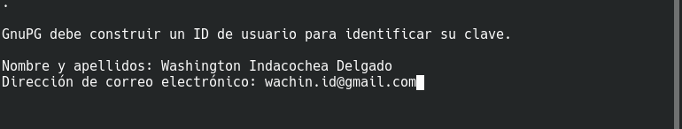
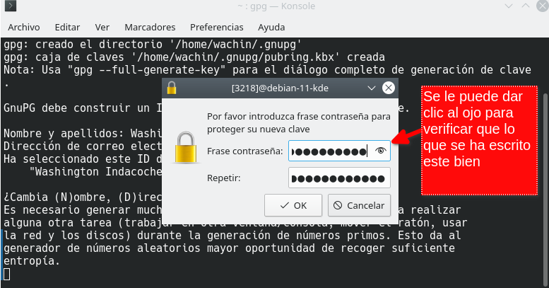
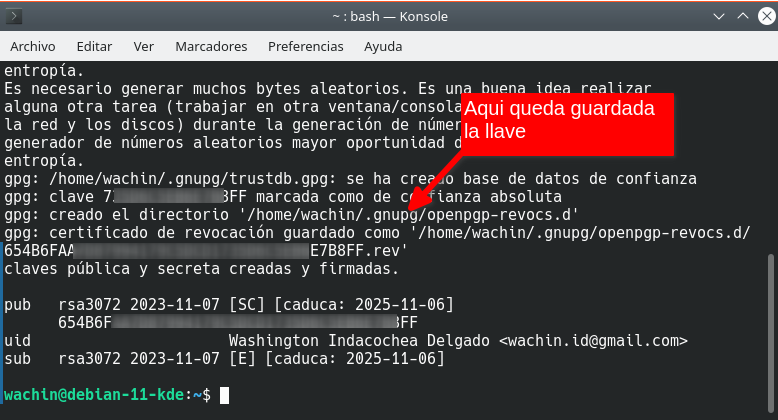
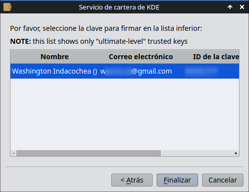
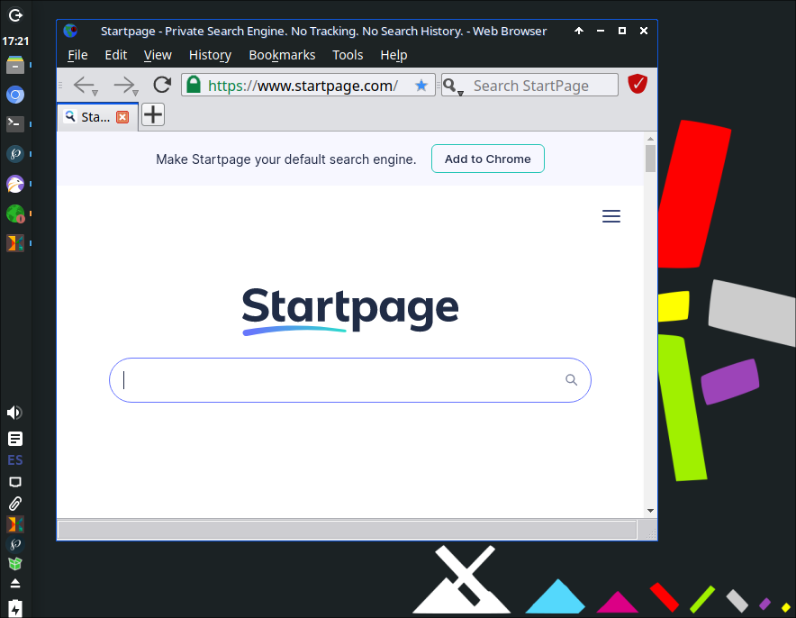
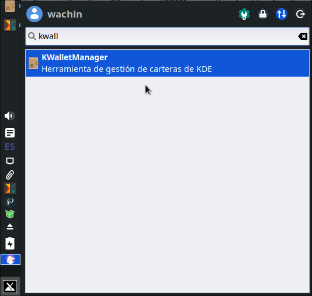

# Cómo configurar la cartera KWallet y en Sistemas Operativos no KDE para usar KDE Apps como Viper Browser, etc, y también en KDE

**Fuente:** https://facilitarelsoftwarelibre.blogspot.com/2023/11/como-configurar-la-cartera-kwallet-de-KDE.html

---

Le puse el título a esta entrada basado en dos circunstancias que me han sucedido:

**1er circunstancia.-** Había instalado [Debian 11 KDE](https://facilitarelsoftwarelibre.blogspot.com/2023/09/donde-descargar-debian-11-bullseye.html.html) y me apareció en un momento (no recuerdo qué programa quise abrir) una ventana pidiendome una contraseña del Servicio de cartera de KDE, y les cuento que hace varios años atrás cuando instalé Kubuntu para ver como era, me apareció esa ventana pero no sabía que hacer con ello (y como no encontré ningún tutorial a la mano en el Sistema Operativo mismo, ni pude encontrar en internet, lo desinstalé e instaré otro Linux), pero ahora si se que hay que hacer:

**2da. circunstancia.-** Instalé un Sistema Operativo no KDE, llamado MX Linux 21 (<https://sourceforge.net/projects/mx-linux/files/Old/MX-21.3/Xfce/>) la versión XFCE e instalé a Viper Browser (sudo apt install viper-browser), y al abrirlo me apareció el Servicio de cartera de KDE:

  
  

y bueno esta es la:

**Solución para la segunda circunstancia,** entonces tenemos que yo he abierto Viper Browser y apareció ese mensaje que dice:

La aplicación "**Viper-Broser** " ha solicidado crear una nueva carpeta con el nombre "**kdewallet** ". Esto se usa para almacenar información importante de un modo seguro. Escoja el nuevo tipo de cartera abajo, o pulse "Cancelar" si desea denegar la petición de la aplicación.

**Nota** : En caso de que no está instalado kdewallet instalelo con:
    
    
    sudo apt install kwalletmanager

Elijo la segunda opción:

"Usar cifrado GPG, para una mejor protección"

y dejo esa ventana abierta sabiendo que se creará una nueva carpeta con el nombre "kdewallet", y pongo en la terminal:

  

### Crear GPG Key

Poner en la terminal:
    
    
    gpg --gen-key

aparecerá en la terminal. En la siguiente imagen yo he puesto mi nombre:

   

y le doy enter  

luego el correo:

  

le digo que vale:

  

luego escribiendo la frase de la contraseña para proteger su nueva clave, hay que escrbir una contraseña, **creela con letras mayusculas y minuscula, numeros (y algún caracter dificil)** , ejemplo yo la he creado algo así:

Lubuntu-587903920 

  
  

pero esta ventana congela las demás ventanas (sólo podrá usar esa) así que aconsejo en un cuaderno escribir la contraseña (o en su celular) y luego escribirla en la ventana (porque después se cierra y deberán repetir el proceso desde el inicio):

y aparecerá así:

  

Recuerde guardar sus datos. Ahora le doy **Siguiente** a la ventana:

  
  

y automáticamente aparece seleccionada mi clave GPG:

  
  

  
doy clic en finalizar, y voy a buscar a Viper:

  
**  
**

**Nota** : Hay un momento en que le pedirá la contraseña de la cartera, parece que es aquí, debe ponerla

  

y al fin abierto:

  
  

### Usando KWalletManager

En MX Linux 21 la versión XFCE no está instalado KWalletManager pero se lo puede instalar así:
    
    
    sudo apt install kwalletmanager
    

  

cabe notar que MX Linux tiene una versión KDE (<https://sourceforge.net/projects/mx-linux/files/>) y allí si está instalada, además de Kubuntu y otros Linux que usen KDE. Lo abrimos:

  
vemos que la cartera se llama:

kdewallet

nombre el cual fue dado automáticamente:

  
  

### Creando otra cartera con otro nombre

Si por alguna razón desea crear otra cartera, debe dar clic en:

Archivo - Nueva cartera

  
y seguir los pasos

Yo creo que con toda esta información también se puede solucionar lo mismo que puede suceder en un Sistema Operativo Linux KDE, es que ahorita no tengo ninguno a la mano para hacer un tutorial 

Dios les bendiga

  

  

  

