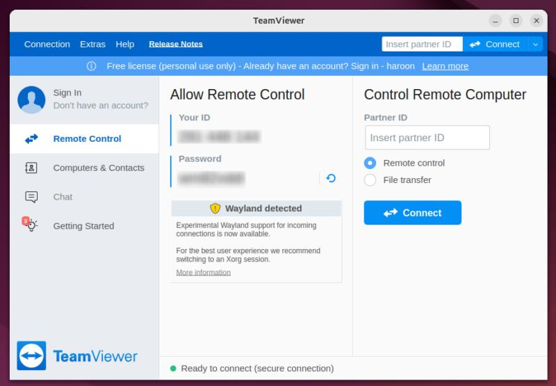
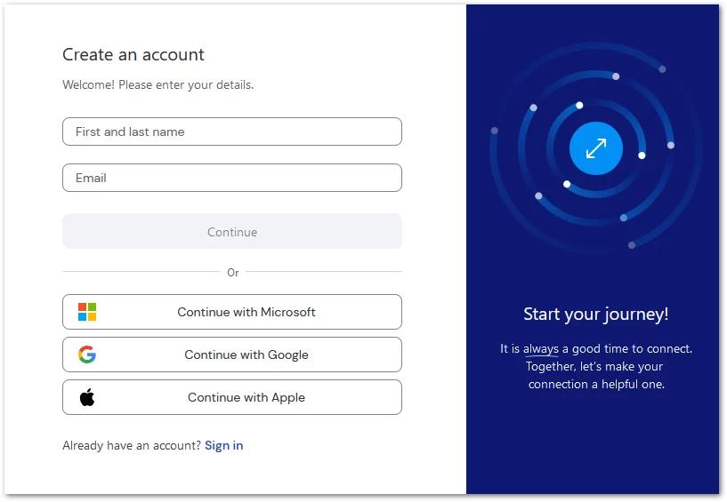
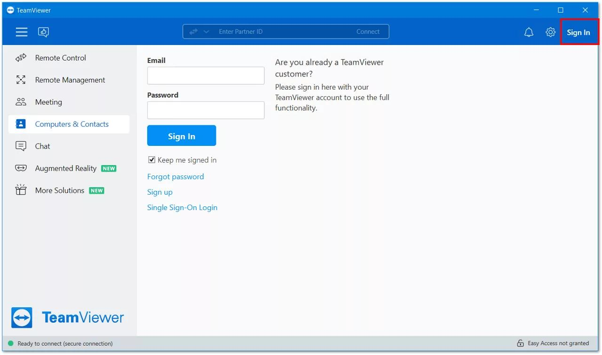
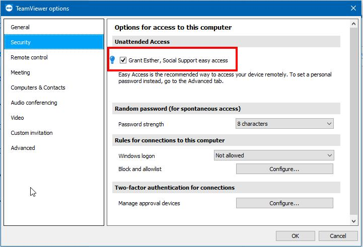
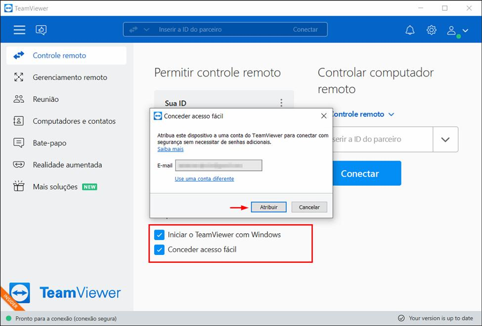
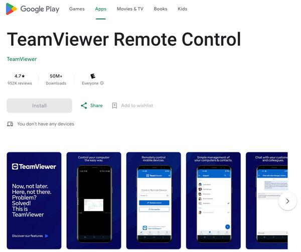
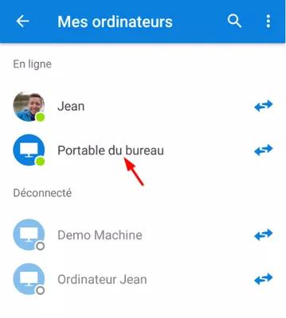
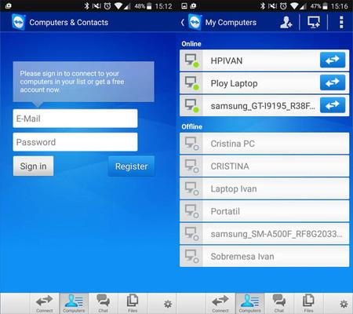

# Cómo controlar remotamente Linux Debian 12 desde un celular Android con TeamViewer sin intervención de otra persona



[maketecheasier.com](https://www.maketecheasier.com/control-linux-computer-from-mobile-phone/)

Tutorial · Linux Debian 12 · Android · TeamViewer

## Introducción

En algunas ocasiones necesitamos acceder a nuestro ordenador desde otro lugar, ya sea para consultar archivos, ejecutar programas, realizar tareas administrativas o solucionar algún problema.

Una de las herramientas que permite hacerlo es TeamViewer. Sin embargo, cuando se utiliza la modalidad habitual de conexión remota, puede ser necesario que alguien esté delante del ordenador para aceptar la solicitud de acceso.

Afortunadamente, TeamViewer dispone de una característica llamada Easy Access (Acceso fácil), que permite conectarse a un ordenador previamente configurado sin que otra persona tenga que aceptar la conexión y sin introducir una contraseña adicional cada vez.

En este tutorial veremos cómo configurar TeamViewer en Linux Debian 12 para controlar el ordenador desde un celular Android, incluso cuando nos encontremos lejos de casa.

## 1. Requisitos necesarios

Antes de comenzar, necesitamos lo siguiente:

- Un ordenador con Linux Debian 12.
- Una conexión a Internet en el ordenador.
- Un celular Android con conexión a Internet.
- TeamViewer instalado en Debian.
- La aplicación TeamViewer Remote Control instalada en Android.
- Una cuenta TeamViewer creada utilizando correo electrónico y contraseña.

Importante: En este procedimiento utilizaremos una cuenta tradicional de TeamViewer, sin recurrir a los botones de autenticación de Google, Microsoft o Apple.

## 2. Crear una cuenta de TeamViewer

Este es uno de los pasos más importantes del procedimiento.

Para crear la cuenta, debemos ingresar a la siguiente dirección:

[https://account.teamviewer.com/](https://account.teamviewer.com/)

Activate your Remote Management License



[teamviewer.com](https://www.teamviewer.com/en/global/support/knowledge-base/teamviewer-remote/remote-management/activate-your-remote-management-license/)

En la página de registro encontraremos diferentes opciones para iniciar sesión o crear una cuenta:

- Continue with Microsoft.
- Continue with Google.
- Continue with Apple.

En este procedimiento no utilizaremos ninguna de esas opciones.

En su lugar, debemos introducir directamente una dirección de correo electrónico y pulsar Continue.

A continuación:

1. Introducimos una dirección de correo electrónico.
2. Creamos una contraseña.
3. Seguimos las instrucciones que aparecen en pantalla.
4. Completamos la verificación del correo electrónico si se solicita.
5. Finalizamos el registro.

De esta manera tendremos una cuenta TeamViewer que utiliza directamente nuestro correo electrónico y contraseña, sin depender de la autenticación de terceros.

Nota: Si una dirección de correo ya está vinculada a una cuenta que utiliza autenticación externa, conviene utilizar otra dirección para crear la nueva cuenta tradicional.

## 3. Iniciar sesión en TeamViewer desde Debian 12

Una vez creada nuestra cuenta, debemos abrir TeamViewer en el ordenador Linux.

En la interfaz del programa:

1. Buscamos el icono del usuario, situado en la parte izquierda.
2. Pulsamos sobre él.
3. Introducimos el correo electrónico de nuestra nueva cuenta.
4. Introducimos la contraseña.
5. Iniciamos sesión.

[Activate your Remote Worker(s)](https://images.openai.com/static-rsc-4/5jlLUdAhfXLUf7at0sgOvrWLv8DqTbkgHUXNEMa08aWeXajB9rJ60YfyKkcDQoEAmwx75cUuFvN3GIyAhj_Umg_coVV-d-JEUcF3YuFzmveYjtbaAr-6RGjf_H-8aDdTvGMkrIRJlp58D2y6HeUkB3YKWVtiiA2OsuF0yRAKIhI?purpose=inline)



[teamviewer.com](https://www.teamviewer.com/en/global/support/knowledge-base/teamviewer-classic/licensing/license-activation/activate-your-remote-worker-s/)

Si los datos son correctos, TeamViewer iniciará sesión con nuestra nueva cuenta.

## 4. Configurar el acceso no presencial (Easy Access)

Ahora vamos a configurar el ordenador para que pueda recibir conexiones remotas sin necesitar la intervención de otra persona.

En TeamViewer, debemos dirigirnos al menú superior:

Extras → Opciones → Seguridad



[community.teamviewer.com](https://community.teamviewer.com/English/discussion/114616/grant-easy-access-please-help)

En la pestaña Seguridad encontraremos una sección denominada:

Opciones para el acceso a este equipo

Dentro de ella aparece el apartado:

Acceso no presencial

Y la opción:

Conceder al Usuario acceso fácil

Esta característica permite que la cuenta de TeamViewer autorizada pueda conectarse al dispositivo de forma segura sin necesidad de introducir contraseñas adicionales.

Al seleccionar esta opción, aparecerá una ventana similar a la siguiente:



[community.teamviewer.com](https://community.teamviewer.com/Portuguese/kb/articles/108689-configure-o-acesso-nao-supervisionado)

La ventana solicita los siguientes datos:

- Correo electrónico.
- Contraseña.
- Casilla «Conceder acceso fácil».
- Botón «Asignar a cuenta».

Debemos introducir las credenciales de la cuenta que acabamos de crear y marcar la casilla Conceder acceso fácil.

A continuación, pulsamos el botón para asignar el dispositivo.

Autorización del sistema Linux

Durante este procedimiento, TeamViewer puede solicitar la contraseña del superusuario o administrador de Linux.

Esto es normal: el sistema necesita autorización administrativa para realizar determinadas operaciones de configuración y asignación del dispositivo.

Introducimos nuestra contraseña de administrador y continuamos.

Una vez completado el procedimiento, el ordenador quedará asociado a nuestra cuenta TeamViewer.

## 5. Instalar TeamViewer en Android

Ahora debemos preparar el celular desde el que controlaremos el ordenador.

How to Remote Control Android Phone from Your PC Easily



TeamViewer Remote Control

Es la aplicación que permite controlar otros dispositivos desde Android.

[Descargar desde Google Play](https://play.google.com/store/apps/details?id=com.teamviewer.teamviewer.market.mobile\)

Si ya teníamos instalada la aplicación, podemos utilizarla. Si habíamos tenido problemas con una sesión anterior, podemos cerrar sesión y volver a iniciar sesión con la nueva cuenta.

Los pasos son:

1. Abrimos TeamViewer Remote Control.
2. Iniciamos sesión con el correo electrónico y la contraseña de nuestra nueva cuenta.
3. Entramos en la sección Devices.
4. Buscamos nuestro ordenador dentro de My computers.



## 6. Conectarnos al ordenador Linux desde el celular

Una vez localizado nuestro ordenador en la lista de dispositivos, simplemente debemos seleccionarlo.

A continuación, pulsamos:

Connect



Si la configuración se ha realizado correctamente, TeamViewer establecerá la conexión directamente, sin solicitar una contraseña adicional y sin que nadie tenga que aceptar la solicitud desde el ordenador Linux.

Acceso remoto configurado

Ahora podremos visualizar y controlar el escritorio de Debian 12 desde nuestro celular Android.

Podremos utilizar el teclado virtual, el ratón y los controles táctiles para interactuar con el ordenador.

## 7. Consideraciones importantes

Para que el acceso remoto funcione cuando estemos fuera de casa, debemos tener en cuenta algunas condiciones:

- El ordenador Linux debe permanecer encendido.
- Debe disponer de conexión a Internet.
- El servicio de TeamViewer debe estar funcionando.
- No debemos permitir que el ordenador entre en suspensión si necesitamos acceder a él en cualquier momento.
- La cuenta TeamViewer debe permanecer autorizada en el dispositivo.

En Debian podemos comprobar el estado del servicio desde una terminal:

```
systemctl status teamviewerd
```

También podemos comprobar que se inicie automáticamente:

```
sudo systemctl enable teamviewerd
```

Recomendación de seguridad: Protege tu cuenta TeamViewer con autenticación de dos factores. No compartas tus credenciales y evita conceder acceso mediante grupos compartidos a personas que no sean de confianza.

## Conclusión

TeamViewer ofrece una solución muy práctica para quienes necesitan controlar sus ordenadores Linux a distancia.

Gracias a la característica Easy Access, es posible acceder a un ordenador Debian 12 desde un celular Android sin depender de que otra persona esté presente para aceptar la conexión.

Lo más interesante es que, una vez realizada la configuración inicial, basta con abrir TeamViewer en el celular, entrar en la sección Devices, seleccionar nuestro ordenador y pulsar Connect.

De esta manera podemos administrar nuestro equipo Linux desde cualquier lugar donde tengamos conexión a Internet.

## 8. Resumen del procedimiento

## Esquema de configuración

1. Crear una cuenta TeamViewer tradicional

   Utilizar correo electrónico y contraseña, sin autenticación de Google, Microsoft o Apple.

2. Iniciar sesión en Debian 12

   Acceder desde el icono del usuario en TeamViewer.

3. Activar Easy Access

   Extras → Opciones → Seguridad → Conceder acceso fácil.

4. Asignar el ordenador

   Introducir las credenciales y autorizar la operación con la contraseña administrativa de Linux si se solicita.

5. Iniciar sesión desde Android

   Utilizar la misma cuenta TeamViewer.

6. Conectarse al ordenador

   Devices → My computers → Seleccionar ordenador → Connect.

¡Listo! Acceso remoto sin confirmación presencial.

### Una sugerencia para tu blog

Te recomiendo agregar una pequeña nota al final del artículo:

> Este tutorial se ha elaborado y probado utilizando Linux Debian 12, TeamViewer 15.83.3 y un dispositivo Android. Las opciones y la apariencia de TeamViewer pueden variar dependiendo de la versión instalada.

Así los lectores sabrán cuál fue el entorno en el que se comprobó el procedimiento.

También te recomiendo conservar esta experiencia como un tutorial independiente: la solución más valiosa que encontraste fue crear una cuenta tradicional con correo y contraseña, en lugar de utilizar los proveedores de autenticación externa. Es precisamente el detalle que puede ayudar a otros usuarios de Linux que se encuentren con el mismo problema.
